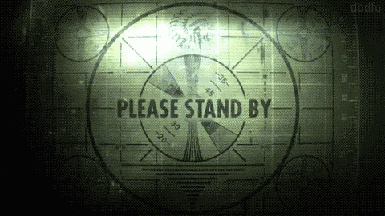
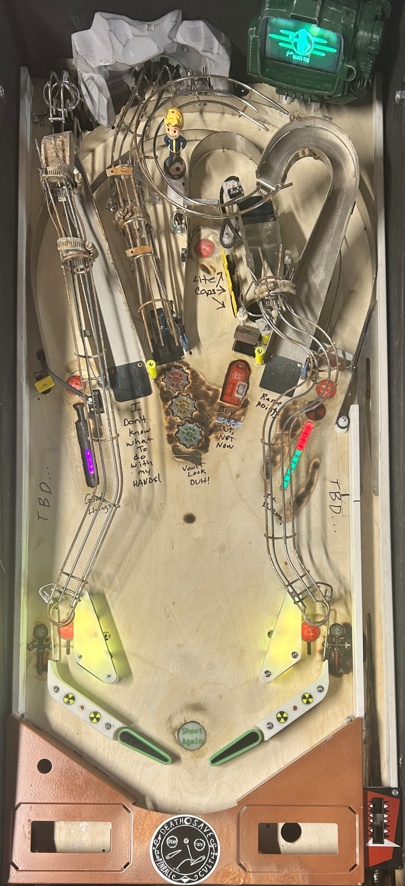

fallout
=======

fallout pinball bitches

Requirements
------------

- [Mission Pinball Framework](https://missionpinball.org) 0.80 (`pip install 'mpf==0.80.*'`)
- [Godot 4](https://godotengine.org) for the display/sound (Godot MC). The GMC
  addon is vendored in `addons/mpf-gmc`. Put `godot` on your PATH or set
  `GODOT_BIN`.

Displays live in Godot scenes: `window.tscn`, `slides/` and `widgets/`. Sound
buses are in `default_bus_layout.tres` + `gmc.cfg`, keyboard mappings in `gmc.cfg`.
Open the project folder in Godot to edit slides.

Running the Game
----------------

- Production: `bin/run`
- Development: `bin/dev`
- Test Suite: `bin/test`

